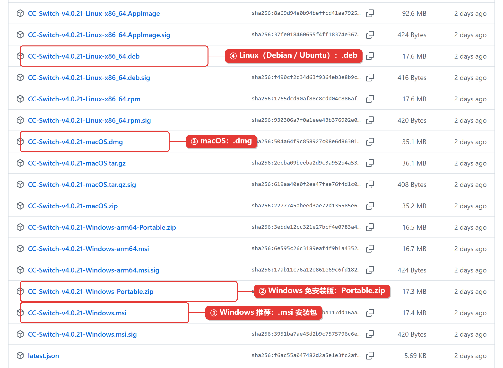
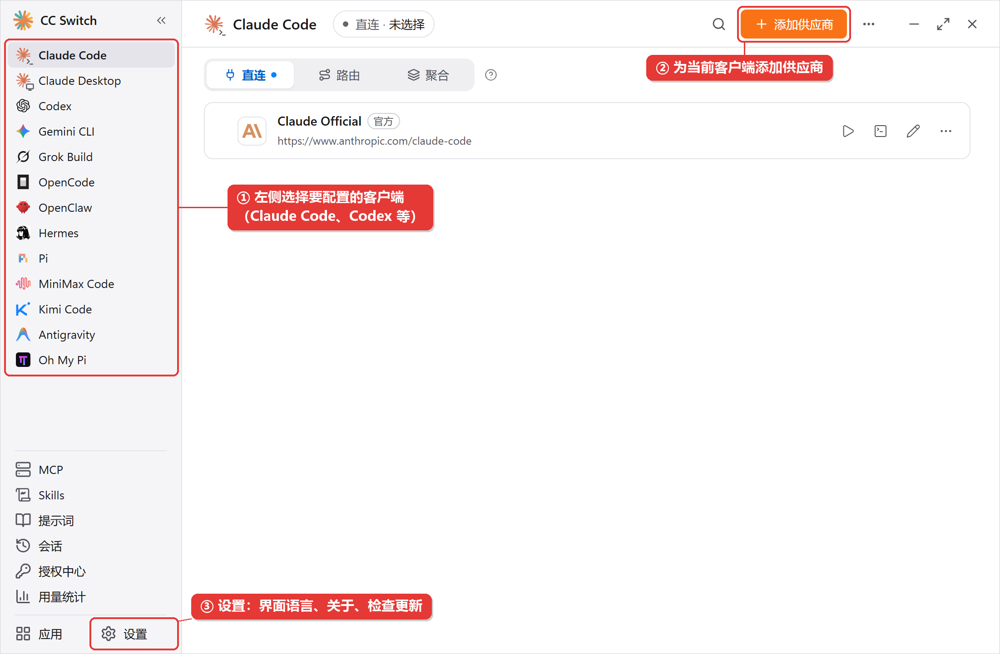
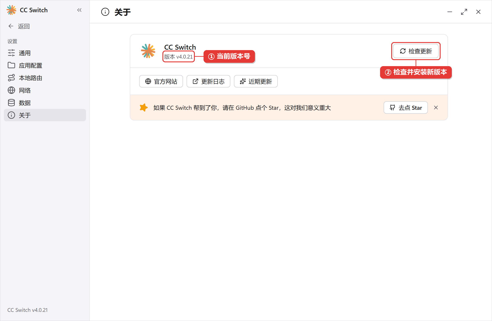

CC Switch 可以集中管理 Codex、Claude Code 和 Gemini CLI 的供应商配置。本文介绍安装流程和界面；接入跨界 AI 的具体步骤见 [Codex 配置指南](/codex/introduction) 和 [Claude Code 配置指南](/claude-code/introduction)。

## 系统要求

| 系统 | 要求 |
| - | - |
| Windows | Windows 10 及以上（x64 或 ARM64） |
| macOS | macOS 12（Monterey）及以上，支持 Intel 和 Apple 芯片 |
| Linux | x86_64 或 ARM64；需要 glibc 2.35+ 和 WebKitGTK 4.1 |

## 一、下载安装包

前往 [CC Switch GitHub Releases](https://github.com/farion1231/cc-switch/releases/latest)，选择与操作系统匹配的安装包。

在 CC Switch GitHub Releases 页面选择对应系统的安装包。

<Frame>

</Frame>

## 二、安装

### Windows

- **安装版（.msi）**：双击安装包，按向导完成安装，然后从开始菜单启动 CC Switch。
- **免安装版（Portable.zip）**：解压到任意文件夹，运行其中的 `cc-switch.exe`。

如果系统显示安全提醒，请确认安装包来自上方 GitHub Releases 页面后再继续。

### macOS

也可以使用 Homebrew 安装：

```bash theme={null}
brew install --cask cc-switch
```

下载 `.dmg` 安装包时，打开后将 CC Switch 拖入“应用程序”文件夹。

### Linux

根据发行版选择 GitHub Releases 中提供的 `.deb`、`.rpm` 或 `.AppImage` 安装包。Debian/Ubuntu 可使用 `apt` 安装 `.deb`，Fedora/RHEL 可使用 `dnf` 安装 `.rpm`；AppImage 需要先添加可执行权限后运行。

## 三、首次启动

首次启动时阅读欢迎说明并确认。若之前已经配置过 Codex 或 Claude Code，CC Switch 可以导入现有配置；导入前请核对客户端当前配置是否已备份。

首次启动 CC Switch 时显示的欢迎说明。

<Frame>

</Frame>

## 四、认识主界面

左侧栏用于选择要配置的客户端；选中客户端后，可在主区域添加和切换供应商。各客户端的供应商列表分别管理。

CC Switch 主界面及客户端列表。

<Frame>

</Frame>

## 五、常用设置

### 切换界面语言

在设置中选择界面语言，按提示应用更改。

在 CC Switch 设置中切换界面语言。

<Frame>

</Frame>

### 查看版本与检查更新

打开“关于”页面查看当前版本，并按页面提示检查更新。

在 CC Switch 关于页面查看版本并检查更新。

<Frame>

</Frame>

## 下一步

- [通过 CC Switch 接入 Codex](/codex/introduction)
- [通过 CC Switch 接入 Claude Code](/claude-code/introduction)
