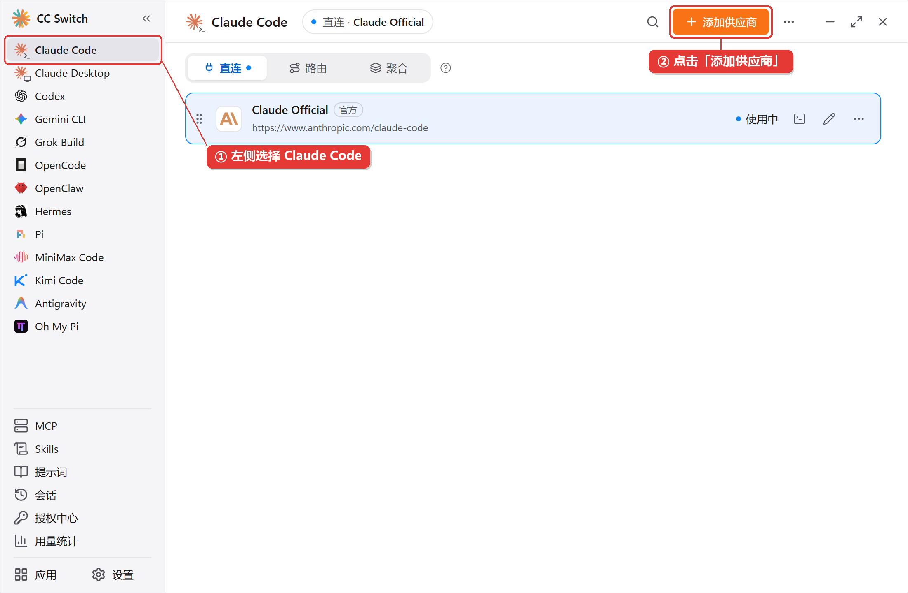
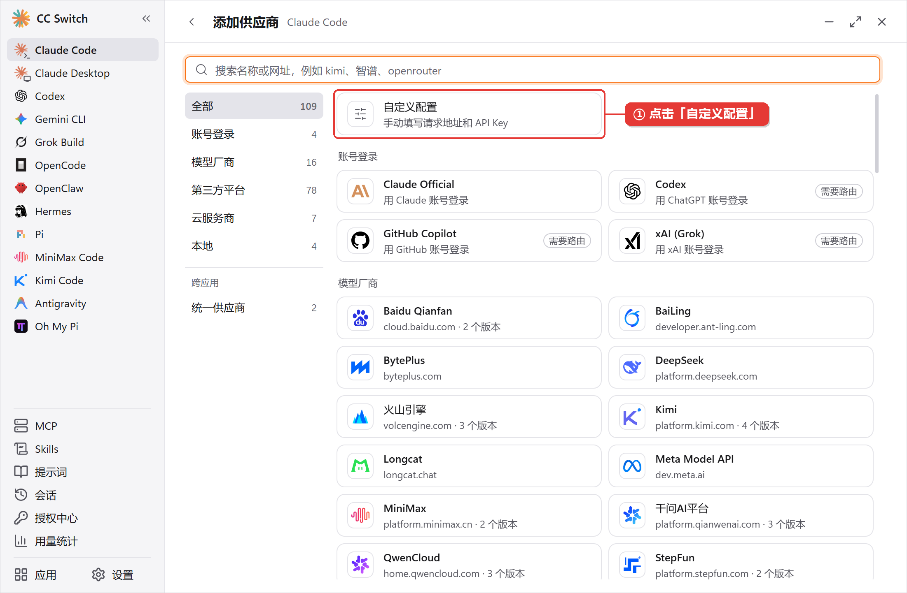
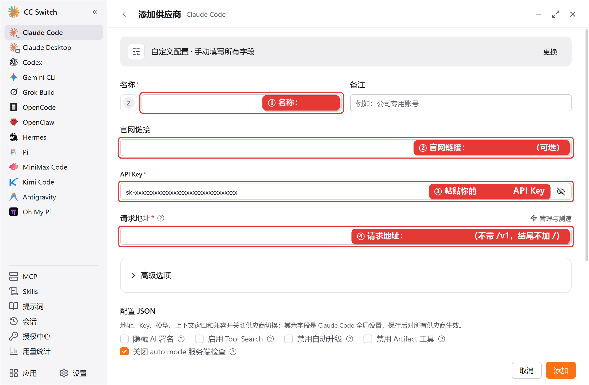
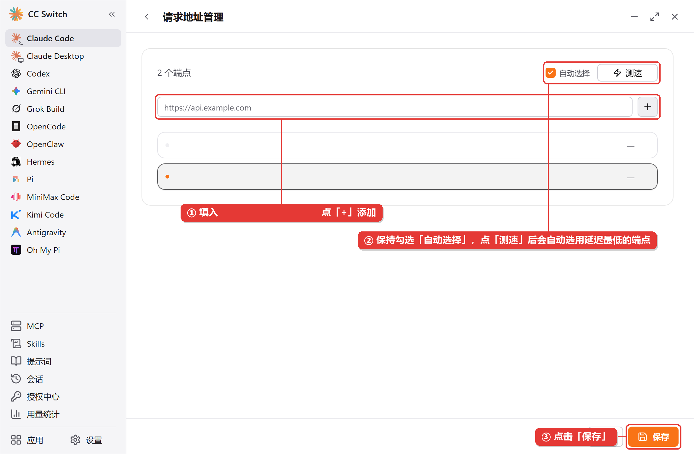
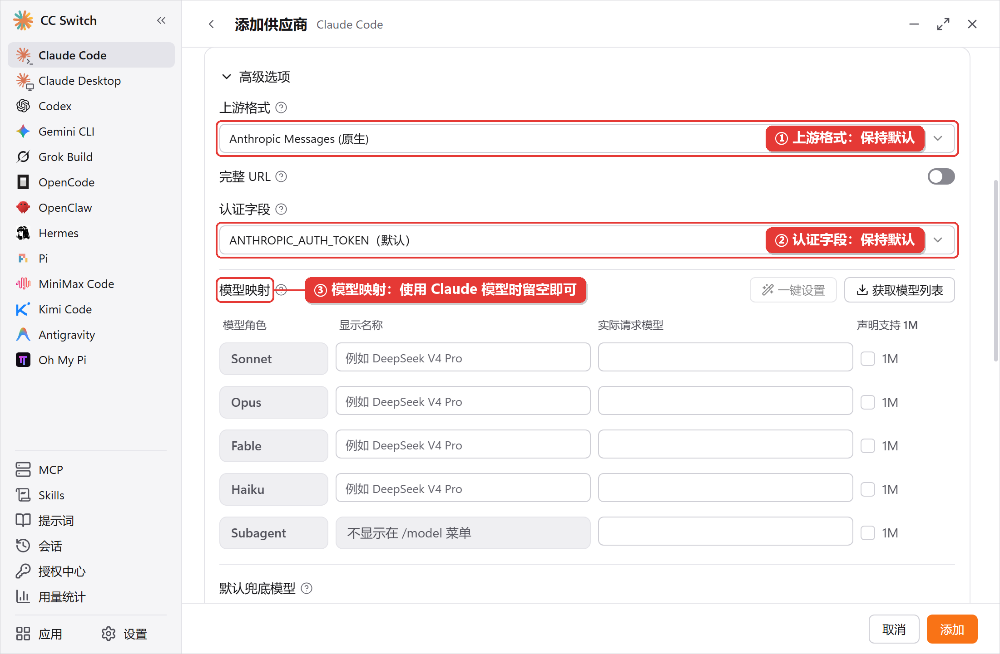
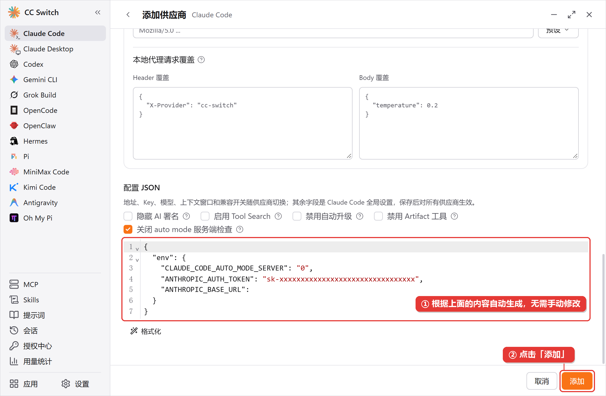
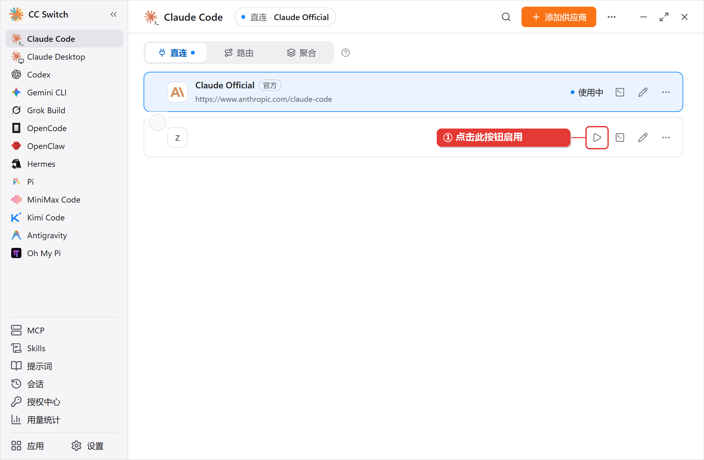
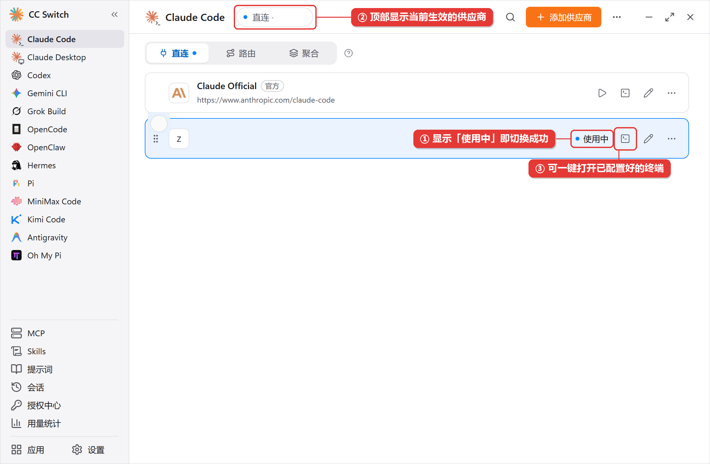
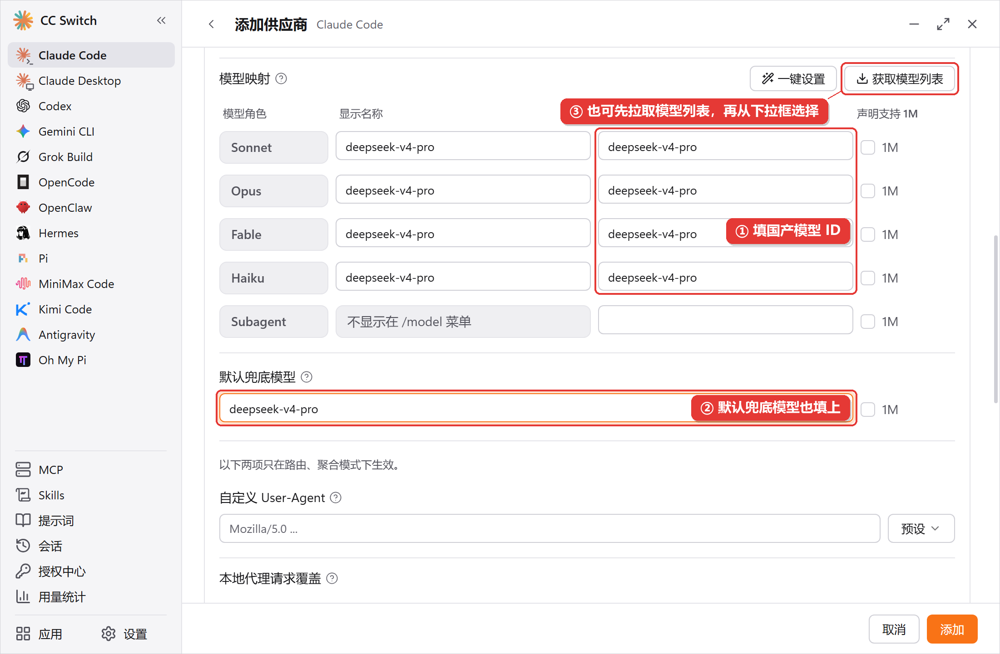

> Claude Code 安装与配置教程

本页介绍如何安装 Claude Code，并将其配置为使用 跨界AI 服务

## 环境准备

> [!NOTE]
>
> * **系统要求**：macOS 13.0+、Windows 10 1809+、Ubuntu 20.04+、Debian 10+ 或 Alpine Linux 3.19+，内存 4 GB 以上
> * **Node.js**：使用官方安装脚本、Homebrew 或 WinGet 安装时不需要 Node.js
> * **Git for Windows**：可选，安装后 Claude Code 可使用 Git Bash 执行命令；未安装时会改用 PowerShell

## 安装

**macOS**

**方法一：官方安装脚本（推荐）**

```bash theme={null}
curl -fsSL https://claude.ai/install.sh | bash
```

官方脚本安装的版本会在后台自动更新

**方法二：Homebrew**

```bash theme={null}
brew install --cask claude-code
```

> [!NOTE]
>
> `claude-code` 跟随稳定版通道，通常比最新版晚一周左右；想第一时间获取新版本可安装 `claude-code@latest`。Homebrew 安装的版本不会自动更新，需要手动运行 `brew upgrade claude-code`

**Windows**

**方法一：官方安装脚本（推荐）**

PowerShell：

```powershell theme={null}
irm https://claude.ai/install.ps1 | iex
```

CMD：

```bat theme={null}
curl -fsSL https://claude.ai/install.cmd -o install.cmd && install.cmd && del install.cmd
```

> [!TIP]
>
> 提示符以 `PS C:\` 开头的是 PowerShell，没有 `PS` 的是 CMD。不需要以管理员身份运行

**方法二：WinGet**

```powershell theme={null}
winget install Anthropic.ClaudeCode
```

WinGet 安装的版本不会自动更新，需要定期运行 `winget upgrade Anthropic.ClaudeCode`

**在 WSL 中使用**

打开 WSL 终端，按 Linux 方式安装，并在 WSL 终端中启动 `claude`

**Linux**

**方法一：官方安装脚本（推荐）**

```bash theme={null}
curl -fsSL https://claude.ai/install.sh | bash
```

**方法二：系统包管理器**

Debian、Ubuntu、Fedora、RHEL、Alpine 也可以通过 apt、dnf、apk 安装，参考 [官方文档](https://code.claude.com/docs/en/setup#install-with-linux-package-managers)

安装完成后，**打开一个新的终端窗口**，运行以下命令确认安装成功

```bash theme={null}
claude --version
```

能输出版本号（如 `2.1.287 (Claude Code)`）即表示安装成功。提示命令未找到时，参考 [常见问题](/claude-code/faq)

## 创建 API Key

在控制台 [创建 API Key](/quickstart/api-key) 时，「厂商」选择「Anthropic」

## 配置

编辑配置文件，文件不存在时新建：

* **macOS/Linux**：`~/.claude/settings.json`
* **Windows**：`C:\Users\你的用户名\.claude\settings.json`

```json settings.json theme={null}
{
  "env": {
    "ANTHROPIC_AUTH_TOKEN": "your-api-key-here",
    "ANTHROPIC_BASE_URL": "https://api.kuajieaigc.com",
    "CLAUDE_CODE_DISABLE_NONESSENTIAL_TRAFFIC": "1"
  }
}
```

> [!WARNING]
>
> 将 `your-api-key-here` 替换为你的 API Key。请求地址**不要**加 `/v1`

| 配置项 | 说明 |
| - | - |
| `ANTHROPIC_AUTH_TOKEN` | 你的 API Key |
| `ANTHROPIC_BASE_URL` | 跨界AI 请求地址 |
| `CLAUDE_CODE_DISABLE_NONESSENTIAL_TRAFFIC` | 关闭遥测、错误上报等非必要请求，减少国内网络下的连接报错。同时会关闭自动更新，需要定期手动运行 `claude update` |

> [!NOTE]
>
> 如果 `settings.json` 中已有其他配置，只需把上面的三项合并到 `env` 中，不要整体覆盖文件

## 使用 CC-Switch

在 CC Switch 左侧选择 Claude Code，点击“添加供应商”，并选择自定义配置。

<Frame caption="选择 Claude Code 并开始添加供应商。">
  
</Frame>

<Frame caption="在供应商模板中选择自定义配置。">
  
</Frame>

按本页配置填写供应商名称、官网和 API Key。Claude Code 的请求地址填写 `https://api.kuajieaigc.com`，不要在地址后添加 `/v1`。

<Frame caption="填写跨界 AI 的官网、API Key 和请求地址。">
  
</Frame>

<Frame caption="按需设置端点并测试连接。">
  
</Frame>

高级选项可先保持默认。检查自动生成的配置 JSON 后添加供应商。

<Frame caption="检查 Claude Code 高级选项。">
  
</Frame>

<Frame caption="检查 Claude Code 自动生成的配置 JSON。">
  
</Frame>

添加后点击启用，切换到跨界 AI 供应商。

<Frame caption="在 CC Switch 中启用 Claude Code 供应商。">
  
</Frame>

<Frame caption="确认当前供应商已启用。">
  
</Frame>

需要调用国产模型时，可按需设置模型映射；使用模型广场中的本站模型 ID。

<Frame caption="在 Claude Code 模型映射中配置模型 ID。">
  
</Frame>

## 验证

在终端运行 `claude`，看到对话界面后，输入 `/status` 查看当前配置

```bash theme={null}
claude
```

* `Anthropic base URL` 一行显示 `https://api.kuajieaigc.com`，说明请求地址已生效
* `Auth token` 一行显示 `ANTHROPIC_AUTH_TOKEN`，说明 API Key 已生效

关闭 `/status` 后发送任意消息，能正常回复即表示配置完成

## 在 VS Code 中使用

Claude Code VS Code 扩展的登录检查不读取 `~/.claude/settings.json`，需要在 VS Code 的用户设置中单独配置

**1. 打开用户设置**

在 VS Code 中按 `Cmd+Shift+P`（Windows/Linux 为 `Ctrl+Shift+P`），运行 **Preferences: Open User Settings (JSON)**

**2. 添加配置**

在设置中加入以下内容

```json settings.json theme={null}
{
  "claudeCode.disableLoginPrompt": true,
  "claudeCode.environmentVariables": [
    { "name": "ANTHROPIC_BASE_URL", "value": "https://api.kuajieaigc.com" },
    { "name": "ANTHROPIC_AUTH_TOKEN", "value": "your-api-key-here" }
  ]
}
```

**3. 重启 VS Code**

重启后打开 Claude Code 面板即可使用

> [!WARNING]
>
> 不要把 API Key 写进项目目录下的 `.claude/settings.json`，该文件通常会提交到代码仓库

## 遇到问题

> **[Claude Code 常见问题](/claude-code/faq)**
>
> 查看 Claude Code 配置相关的常见问题
