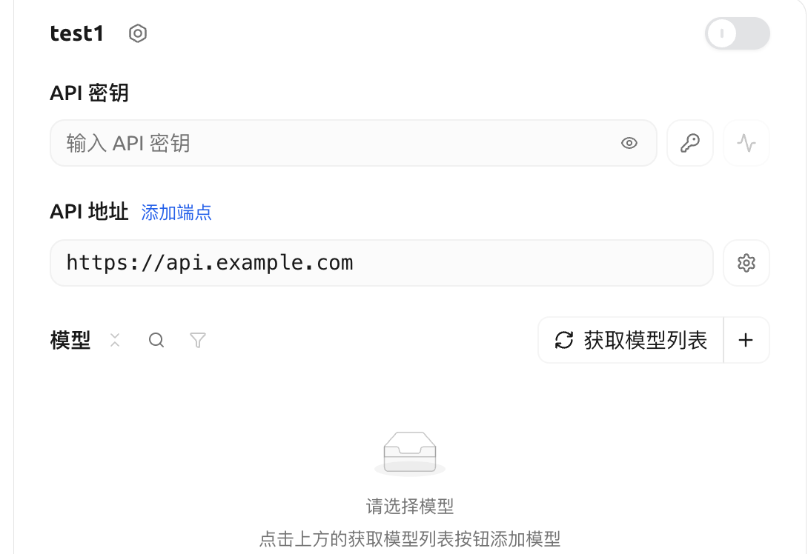

[Cherry Studio](https://www.cherry-ai.com) 是一款开源的 AI 桌面客户端，支持 Windows、macOS 和 Linux，适合日常对话、翻译和知识库问答。按本页添加 跨界 AI 后即可在其中使用 GPT、Claude 等模型

## 下载安装

前往 [Cherry Studio 下载页](https://www.cherry-ai.com/download) 下载对应系统的安装包，运行后按提示完成安装

## 创建 API Key

在控制台 [创建 API Key](/quickstart/api-key) 时，按要使用的模型选择厂商：使用 GPT 选择「OpenAI」，使用 Claude 选择「Anthropic」

## 添加 跨界 AI

**1. 打开模型服务**

点击左下角「设置」，进入「模型服务」，在服务商列表底部点击「添加」

**2. 选择提供商类型**

名称填 `跨界 AI`，按要使用的模型选择提供商类型

| 提供商类型 | 适用模型 |
| - | - |
| `OpenAI` / OpenAI 兼容 | 国产模型、GPT 和 Chat Completions 模型 |
| `OpenAI-Responses` | 使用 Responses 接口的模型和客户端 |
| `Anthropic` | Claude 系列 |

> [!TIP]
>
> 同时使用 GPT 和 Claude 时，分别添加两个提供商，各自填入对应厂商的 API Key

**3. 填写 API 密钥和地址**

| 字段 | 填写内容 |
| - | - |
| API 密钥 | 你的 API Key |
| OpenAI 兼容 API 地址 | `https://api.kuajieaigc.com/v1` |

选择 OpenAI 兼容提供商时，地址填 `https://api.kuajieaigc.com/v1`。如果当前版本把“API 主机”和“API 路径”分开，主机填 `https://api.kuajieaigc.com`，路径填 `/v1/chat/completions`。

Cherry Studio 服务商设置界面示意。图中为第三方文档示例地址，请按上表填写跨界 AI 的地址。

<Frame>

</Frame>

> [!WARNING]
>
> 不要同时在 Base URL 和 API 路径中重复填写 `/v1`。以设置页面显示的完整请求地址为准。

**4. 添加模型**

点击「管理」，从拉取到的模型列表中点击「+」添加需要的模型。也可以点击「添加」手动填写模型 ID，如 `your-model-id`

**5. 检测并启用**

点击 API 密钥右侧的「检测」，选择一个模型，提示连接成功即可。最后打开提供商右上角的开关启用它

## 开始对话

回到对话页面，在顶部的模型选择中选择 跨界 AI 下的模型，发送消息，能正常回复即表示配置完成

## 常见问题

> **检测失败或提示 404**
>
> * OpenAI 兼容提供商使用 `https://api.kuajieaigc.com/v1`，或按分开的字段填写主机和 `/v1/chat/completions`
> * 确认提供商类型与 API Key 的厂商一致：国产模型使用 OpenAI 兼容入口，Claude 使用 `Anthropic`

> **提示 401 或认证失败**
>
> 确认 API Key 已完整复制（无多余空格），并且在有效期内、余额充足

> **拉取不到模型列表**
>
> 点击「添加」手动填写模型 ID 即可，模型 ID 区分大小写

> **连接超时或无法访问**
>
> 确认域名为 `api.kuajieaigc.com`，并检查当前字段是否要求 `/v1`。
