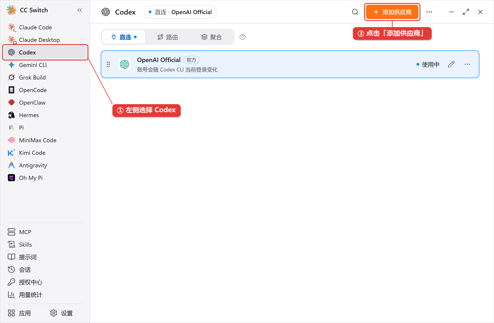
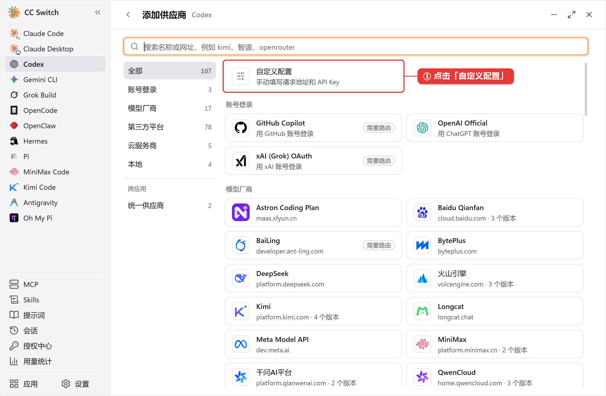
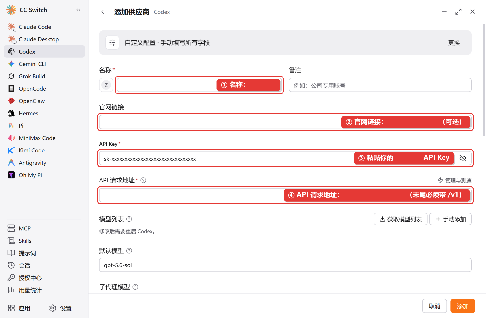
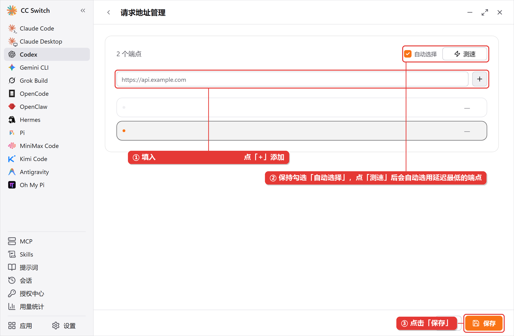
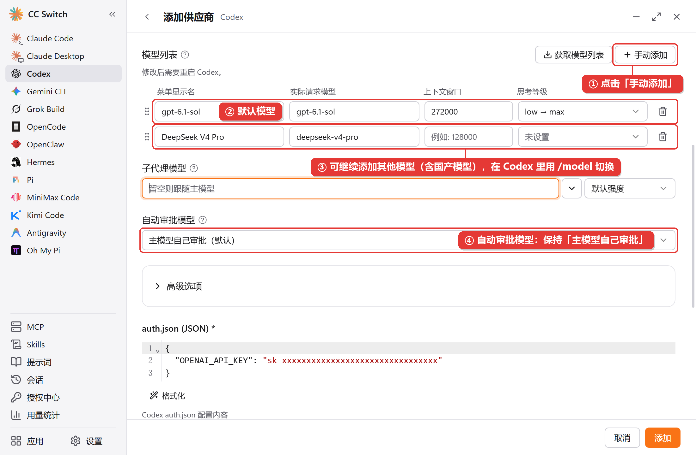
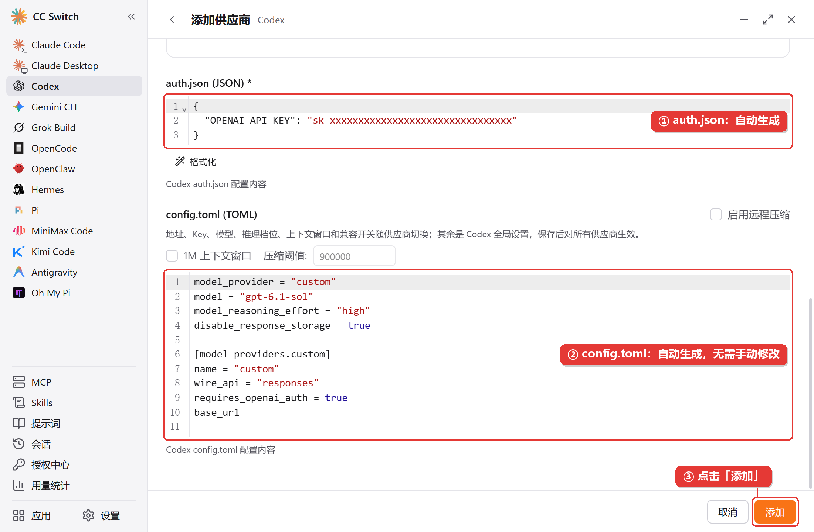
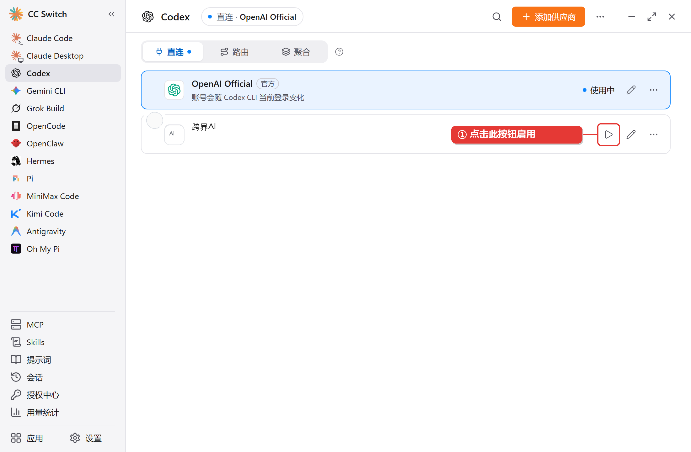
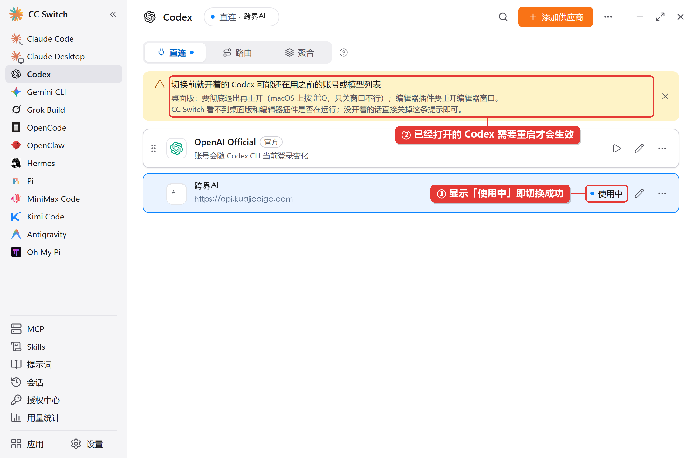

> Codex 安装与配置教程

本页介绍如何安装 Codex，并将其配置为使用 跨界AI 服务

## 环境准备

> [!NOTE]
>
> 通过 npm 安装需要 Node.js 18 或更高版本，请先完成 [环境配置](/environment/setup)

## 安装

**macOS**

**方法一：官方安装脚本（推荐）**

```bash theme={null}
curl -fsSL https://chatgpt.com/codex/install.sh | sh
```

**方法二：Homebrew**

```bash theme={null}
brew install --cask codex
```

**方法三：NPM（国内镜像）**

```bash theme={null}
npm i -g @openai/codex --registry=https://registry.npmmirror.com
```

**Windows**

**方法一：官方安装脚本（推荐）**

在 PowerShell 中运行：

```powershell theme={null}
powershell -ExecutionPolicy ByPass -c "irm https://chatgpt.com/codex/install.ps1 | iex"
```

**方法二：NPM（国内镜像）**

```powershell theme={null}
npm i -g @openai/codex --registry=https://registry.npmmirror.com
```

> [!TIP]
>
> 如果你习惯在 WSL 中开发，也可以在 WSL 终端里按 Linux 方式安装，此时配置文件位于 WSL 内的 `~/.codex/`

**Linux**

**方法一：官方安装脚本（推荐）**

```bash theme={null}
curl -fsSL https://chatgpt.com/codex/install.sh | sh
```

**方法二：NPM（国内镜像）**

```bash theme={null}
npm i -g @openai/codex --registry=https://registry.npmmirror.com
```

> [!NOTE]
>
> 官方安装脚本从 `chatgpt.com` 下载。网络无法访问时，改用 NPM 国内镜像安装，NPM 方式需要先准备 [Node.js 环境](/environment/setup)

安装完成后，打开一个新的终端窗口，运行以下命令确认安装成功

```bash theme={null}
codex --version
```

## 配置

配置文件位于：

* **macOS/Linux**：`~/.codex/`
* **Windows**：`C:\Users\你的用户名\.codex\`

**1. 创建 config.toml**

```toml theme={null}
model_provider = "OpenAI"
model = "your-model-id" # 从模型广场复制实际模型 ID
model_reasoning_effort = "xhigh"
disable_response_storage = true
model_verbosity = "high"
network_access = true

[model_providers.OpenAI]
name = "OpenAI"
base_url = "https://api.kuajieaigc.com/v1"
wire_api = "responses"
requires_openai_auth = true
```

> [!NOTE]
>
> **Windows 用户**可在 `config.toml` 开头额外添加 `windows_wsl_setup_acknowledged = true`，跳过首次启动时的 Windows 引导提示

**2. 创建 auth.json**

```json theme={null}
{
  "OPENAI_API_KEY": "your-api-key-here"
}
```

> [!WARNING]
>
> 将 `your-api-key-here` 替换为你的 API Key

> [!TIP]
>
> 想用图形界面？ChatGPT 桌面应用的 Codex 模式和命令行共用这份配置，参考 [ChatGPT 桌面应用安装与配置](/codex/chatgpt-app)

## 使用 CC-Switch

在 CC Switch 左侧选择 Codex，点击“添加供应商”，并选择自定义配置。

<Frame caption="选择 Codex 并开始添加供应商。">
  
</Frame>

<Frame caption="在供应商模板中选择自定义配置。">
  
</Frame>

按本页配置填写供应商名称、官网、API Key 和请求地址。OpenAI 兼容地址使用 `https://api.kuajieaigc.com/v1`；模型 ID 从[模型广场](https://www.kuajieaigc.com/pricing)复制。

<Frame caption="填写跨界 AI 的官网、API Key 和 API 请求地址。">
  
</Frame>

<Frame caption="按需设置端点并测试连接。">
  
</Frame>

设置默认模型和模型列表时，使用模型广场显示的实际模型 ID。

<Frame caption="设置 Codex 默认模型和模型列表。">
  
</Frame>

添加前检查自动生成的 `auth.json` 和 `config.toml`。请勿在公开位置粘贴真实 API Key。

<Frame caption="检查 CC Switch 自动生成的 Codex 配置。">
  
</Frame>

添加后启用供应商；如果 Codex 已经打开，按提示重启使配置生效。

<Frame caption="点击启用，切换到已添加的供应商。">
  
</Frame>

<Frame caption="确认当前供应商已启用，并按提示重启 Codex。">
  
</Frame>

## 使用

在终端运行 `codex`，看到对话界面并能正常回复即表示配置完成

```bash theme={null}
codex
```

## 遇到问题

> **[Codex 常见问题](/codex/faq)**
>
> 查看 Codex 配置相关的常见问题
